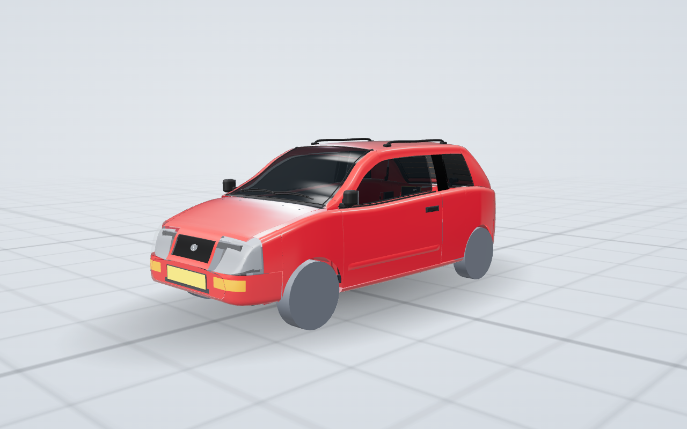

# Alto explosietekening

Interactieve 3D-explosietekening van een Suzuki Alto 1.0-16V Twist (2001): 3-deurs hatchback in Bright Red 2 (Z9T), met de viercilinder G10BB (993 cc, 16 kleppen, één nokkenas met tuimelaars, 43 kW / 58 pk) en een handgeschakelde vijfbak. Het is de Europese Alto op basis van de Maruti Zen, gebouwd van 2000 tot 2002. Elke groep klapt apart uit en in, tot op tuimelaar, zuigerveer en remschoen. De modus Openen laat de motorkap, de portieren, de zijruiten, de spiegels, de achterklep, de tankklep en de rugleuningen opengaan zoals bij de echte auto. Alle geometrie wordt in code opgebouwd; er zijn geen 3D-bestanden.

Live: https://rvd-gmpplus.github.io/alto/ (vanaf `main`). Aantallen onderdelen, driehoeken en presets staan in [docs/cijfers.md](docs/cijfers.md).



## Openen

Open `index.html` in een moderne browser. Het bestand laadt three.js r147 van jsDelivr en lettertypes van Google Fonts; verder is alles ingebouwd. Het werkt op desktop en telefoon, in licht en donker thema. De adresbalk is een deelbare link (`?preset=...`, `?open=Motorkap,Achterklep`); de knop `?` rechtsboven legt de bediening uit. De bediening is gelijk aan die van de referentie-auto, zie de README van [laguna3](https://github.com/rvd-gmpplus/laguna3#bediening).

## Hoe dit gemaakt is

Deze auto is gebouwd met het framework voor explosietekeningen uit [laguna3](https://github.com/rvd-gmpplus/laguna3) (`docs/framework.md`). De generieke laag (bouw, app, tests) komt byte voor byte uit laguna3; het bestand `FRAMEWORK` noemt de bron-commit. Wat bij deze auto hoort, staat in `auto.json`, de domeinbestanden in `src/`, `src/presetdata.js`, `data/silhouet.json`, `tools/anchors.json` en `tools/itest.py`.

| Stap | Waar |
|---|---|
| Onderzoek, met bron en status per feit | [docs/specificaties-en-bronnen.md](docs/specificaties-en-bronnen.md), [docs/onderzoek/beslissingen.md](docs/onderzoek/beslissingen.md) |
| Bouwcontract (maten, motorframe, aansluitpunten, ankers, budgetten, openers) | [docs/contract.md](docs/contract.md) |
| Carrosserie op het gemeten silhouet | `src/body.js`, `src/bodyparts.js` |
| Domeinen, parallel gebouwd | motor `src/engine1-3.js`, aandrijving `src/drivetrain.js`, onderstel `src/chassis.js`, interieur `src/interior.js`, systemen `src/systems.js` |
| Presets en rondleiding | `src/presetdata.js` |
| Tests en basislijn | [docs/testen.md](docs/testen.md), `docs/baseline/` |

## Wat geschat is

Het silhouet is gemeten uit foto's (er is geen maatschets gevonden). Inlaat- en uitlaatzijde, motorhelling, de plaats van accu, tank en einddemper en de overbrengingen van de bak staan niet in de bronnen; het model toont een representatieve opbouw en zegt dat in de beschrijving van elk onderdeel. Feiten in een `spec` zijn geverifieerd. Onderdeelnummers zijn nog niet opgenomen.

## Bouwen en testen

```
tools/setup.sh                              # omgeving: Playwright, Chromium, three.js 0.147.0
python3 build.py --lint && python3 build.py # index.html uit src/
tools/orkestratie/finaltests.sh UITMAP      # volledige strikte set
python3 tools/framework.py check            # generieke laag zonder autonamen
```
